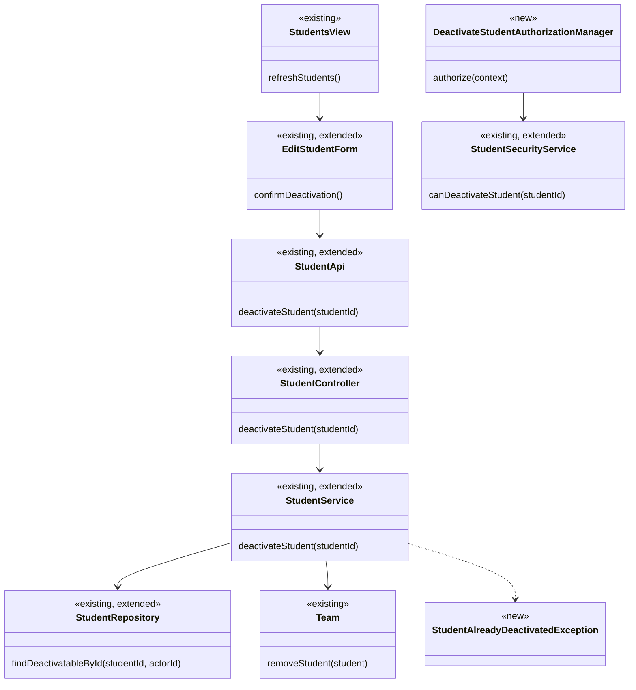
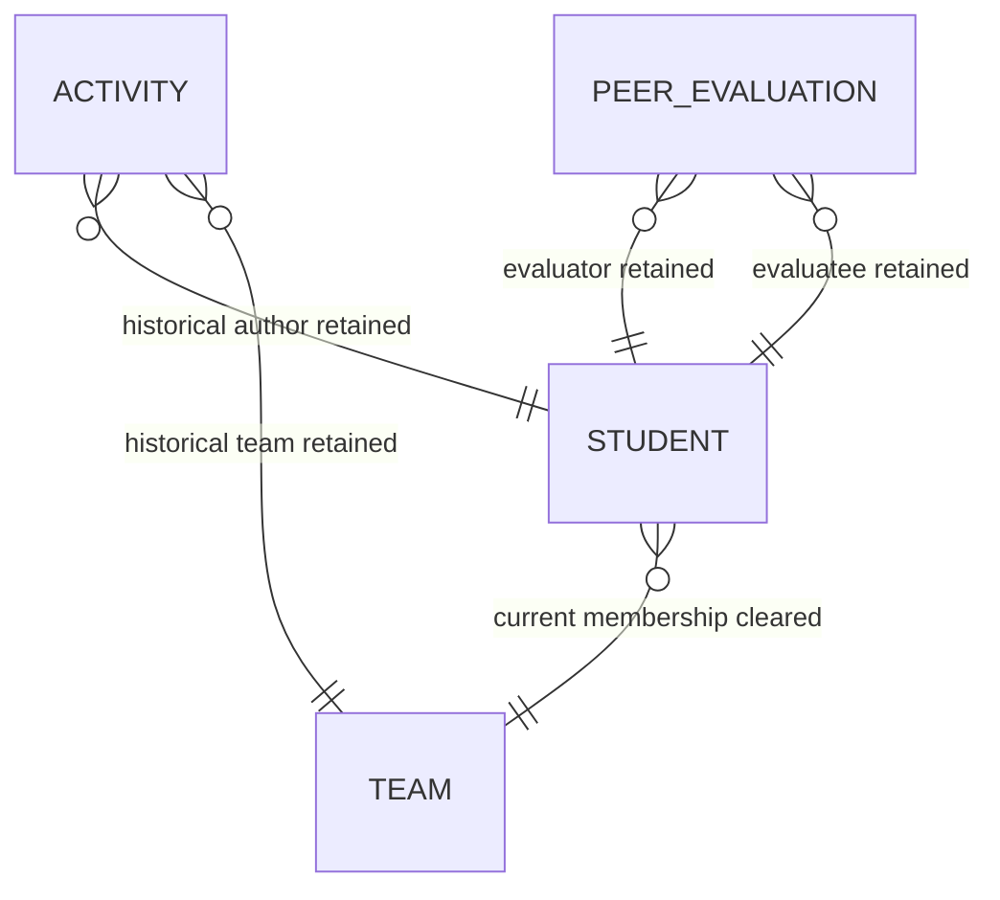

# Student Design

> Realizes: UC-STU-deactivate-student
> Depends on FRs: FR-SEC-authorization, FR-SEC-deny-unauthorized, FR-SEC-active-account
> See: [use cases](../requirements/use-cases.md), [business rules](../requirements/business-rules.md), [software requirements specification](../requirements/software-requirements-specification.md), and [architectural design](architectural-design.md) (Container Diagram, Architectural Conventions, and Crosscutting Concepts).

## Overview

The student area extends the existing student, team, activity, evaluation, and security vertical slices to make deactivation an explicit lifecycle command. It follows the platform's Vue SPA → Spring REST API → MySQL container path and the two authorization enforcement points defined by the architecture-of-record.

## Components & classes



- Reuse and extend [`StudentController`](../../backend/src/main/java/team/projectpulse/student/StudentController.java), [`StudentService`](../../backend/src/main/java/team/projectpulse/student/StudentService.java), and [`StudentRepository`](../../backend/src/main/java/team/projectpulse/student/StudentRepository.java) with the lifecycle command and actor-scoped lookup.
- Add `DeactivateStudentAuthorizationManager` under `security/authorizationmanagers/` and extend [`StudentSecurityService`](../../backend/src/main/java/team/projectpulse/student/StudentSecurityService.java) with its fail-closed predicate; add the explicit route rule in [`SecurityConfiguration`](../../backend/src/main/java/team/projectpulse/security/SecurityConfiguration.java).
- Add `StudentAlreadyDeactivatedException` and its `409 CONFLICT` mapping in [`ExceptionHandlerAdvice`](../../backend/src/main/java/team/projectpulse/system/exception/ExceptionHandlerAdvice.java).
- Extend [`frontend/src/apis/student/index.ts`](../../frontend/src/apis/student/index.ts), [`EditStudentForm.vue`](../../frontend/src/pages/students/EditStudentForm.vue), and [`Students.vue`](../../frontend/src/pages/students/Students.vue). The edit form remains the student-detail surface but replaces its generic status toggle with the explicit destructive action and consequence confirmation.

## Sequence

### UC-STU-deactivate-student main success scenario

```mermaid
sequenceDiagram
    actor Actor as Course admin / assigned instructor
    participant View as EditStudentForm
    participant Client as student API client
    participant Security as SecurityConfiguration
    participant Guard as DeactivateStudentAuthorizationManager
    participant Controller as StudentController
    participant Service as StudentService
    participant Repository as StudentRepository
    participant Team
    participant DB as MySQL

    Actor->>View: choose Deactivate (step 3)
    View->>View: show consequences and confirmation (step 4)
    Actor->>View: confirm (step 5)
    View->>Client: POST deactivation
    Client->>Security: Bearer request
    Security->>Guard: route authorization
    Guard->>Repository: fail-closed relationship check
    Security->>Controller: authorized request
    Controller->>Service: deactivateStudent(studentId)
    Service->>Repository: actor-scoped student lookup
    Service->>Service: verify account is enabled
    Service->>Team: removeStudent(student)
    Service->>Service: set enabled false
    Service->>Repository: save in transaction
    Repository->>DB: update team FK and enabled flag
    Controller-->>Client: Result with StudentDto
    Client-->>View: refresh and show deactivated notice (step 6)
```

The confirmation's Cancel path makes no API call and leaves the student and current team membership unchanged. The server maps an already-deactivated command to `409`; the authorization guard maps an unauthorized or unresolvable route target to `403` before controller dispatch.

## API contract

| Endpoint | Caller | Request | Success | Errors, by extension |
|---|---|---|---|---|
| `POST /api/v1/students/{studentId}/deactivation` | Course admin who owns the student's course, or instructor assigned to the student's course section | `studentId` path variable; no body | `200 Result` with the deactivated `StudentDto` | 3a: `409 Result`, already deactivated; 3b: `403 Result`, no permission |

## Key decisions

- **Current team membership is removed with the account deactivation.** `StudentService` calls the existing `Team.removeStudent(student)` before disabling the account, keeping both JPA sides consistent. Directly nulling `Student.team` was rejected because it leaves `Team.students` inconsistent in the transaction.
- **Historical records remain independent of current membership.** The operation changes only `Student.enabled` and the nullable current-team foreign key. Existing `Activity` rows retain their student and historical team references; existing `PeerEvaluation` rows retain evaluator and evaluatee references. Archive/copy tables were rejected because the existing independent references preserve the required history without duplicating records or changing retrieval.
- **Deactivation is a dedicated command.** The generic update endpoint continues profile editing and does not control lifecycle state. Reusing its `enabled` field was rejected because it bypasses required confirmation, team removal, and lifecycle-specific authorization.
- **Authorization is course/section scoped at both enforcement points.** The new route guard admits only the course owner or a course-section instructor and fails closed. The service then resolves the student through an actor-scoped repository query using `UserUtils.getUserId()` and separately verifies that the account is enabled, so an in-scope deactivated student produces the required `409`. A `ROLE_instructor` check alone, and an unscoped `findById`, were rejected because either permits a cross-course-section mutation.
- **An already-deactivated student is not treated as successful.** The service throws a dedicated exception mapped to `409 CONFLICT`, making extension 3a visible to the actor. A silent idempotent success was rejected because it would not inform the actor as the use case requires.

## Data model

No schema migration is needed. The SRS Business Domain Model already makes `Student.team` optional, while the independent activity and peer-evaluation associations preserve historical records.



## Reuse & cross-cutting

The feature reuses the `Result` envelope, centralized exception mapping, JWT authentication, shared Axios client, `UserUtils` caller identity, JPA transaction boundary, and the two authorization enforcement points. It adds neither locking, validation, email, collaboration, nor a schema migration.

## Tests

| Use case, flow | Level | Asserts |
|---|---|---|
| UC-STU-deactivate-student, main success scenario | Student service unit and API integration | A course admin and assigned instructor can deactivate an active student; the account is disabled, current team membership is removed, and the `Result` succeeds. |
| UC-STU-deactivate-student, historical preservation | API integration | Existing activities and peer evaluations remain retrievable after deactivation; only current team membership changes. |
| UC-STU-deactivate-student, cancellation | Frontend component | Cancelling the consequence confirmation sends no request and leaves displayed state unchanged. |
| UC-STU-deactivate-student, 3a already deactivated | API integration | The operation makes no change and returns `409` with the already-deactivated message. |
| UC-STU-deactivate-student, 3b unauthorized | Route authorization and API integration | A student, unrelated instructor, and non-owning course admin receive `403`; no data changes. |
| UC-STU-deactivate-student, active-account effect | Authentication integration | The deactivated student cannot authenticate or access protected resources until reactivation. |

## Open questions / risks

None. The approved requirements resolve the team-removal and historical-record behavior, and the existing nullable association and independent historical references support it without a schema change.
